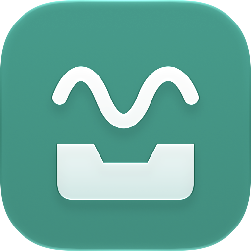
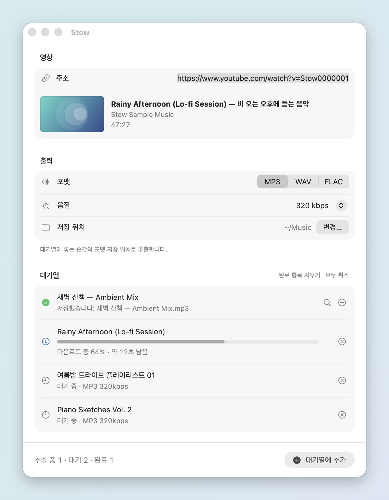
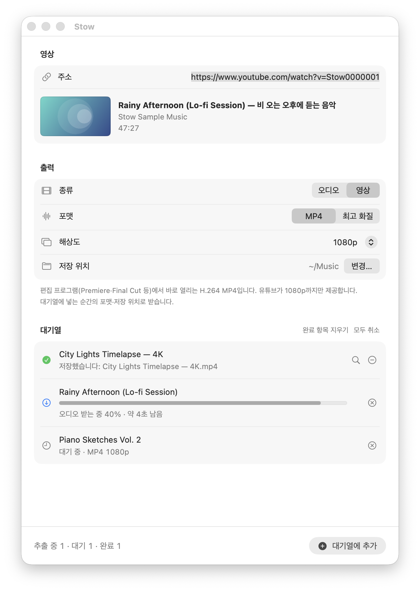
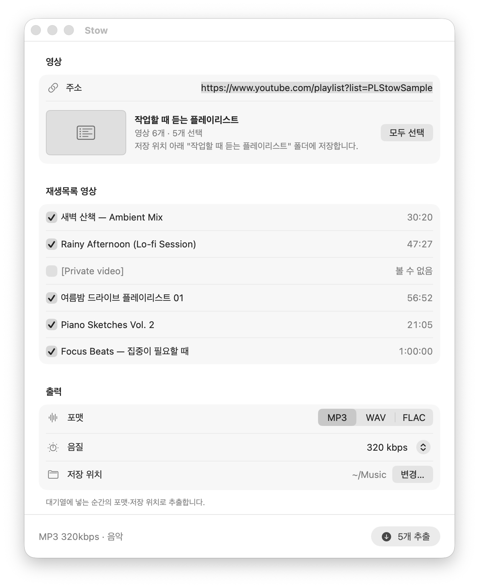
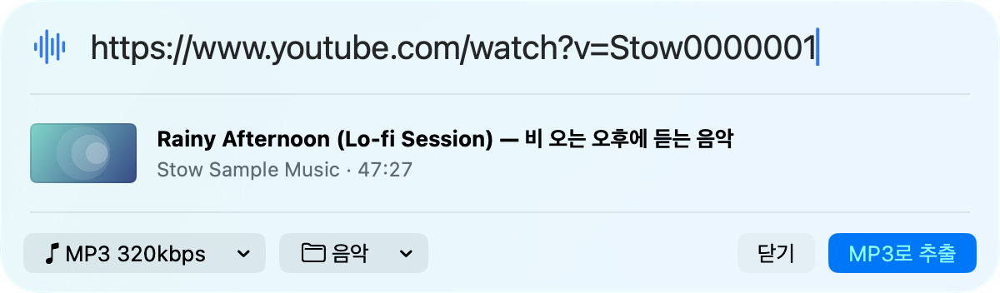

<div align="center">



# Stow

**A native Mac and Windows app that saves YouTube audio (MP3, WAV, FLAC) or video (MP4) — just paste a link**

No ads, no sign-ups, no shady download sites that change their address every week. Everything runs on your computer.

[](https://github.com/choitjddn0311/stow/releases/latest)
[](#requirements)
[](#requirements)
[-555)](#windows)
[](LICENSE)

[**Download for Mac**](https://github.com/choitjddn0311/stow/releases/latest) · [**Download for Windows**](https://github.com/choitjddn0311/stow/releases/tag/win-v0.1.0) · [Website](https://choitjddn0311.github.io/stow/en/) · [Usage](#usage) · [FAQ](#faq) · [한국어](README.md)

<picture>
  <source media="(prefers-color-scheme: dark)" srcset="docs/images/main-dark.png">
  
</picture>

</div>

> **Note:** The app's interface is currently in **Korean only**. The screenshots and this README explain what each part does.

## Why Stow?

YouTube download websites are full of ads and keep moving to new domains, so they are hard to rely on.
Stow is a local Mac app: paste a link and it saves the audio or video in the format, quality, and folder you choose.
It is built for video editors and creators who need audio and footage quickly while they work.

## Features

- **Paste and go** — title, channel, duration, and thumbnail load automatically
- **Your format, your quality** — MP3 (128/192/320 kbps), WAV, FLAC, with title and artist metadata embedded
- **Video, too** — save as editor-friendly MP4 (up to 1080p) or best quality (up to 4K), without re-encoding
- **Queue and playlists** — add as many videos as you like; pick only the videos you want from a playlist
- **Quick extract from anywhere** — press ⌥⌘Y in any app to open a small panel that picks up the link on your clipboard
- **Stays up to date** — new app versions are offered in-app, and the extraction engine (yt-dlp) updates itself when YouTube changes
- **Safe saving** — never overwrites a file with the same name (adds a number instead) and remembers your folder and format
- **Feels like macOS** — System Settings–style layout, light and dark mode, full keyboard control, VoiceOver support
- **Windows too** — version 0.1 for Windows 10 and 11 (see [below](#windows))

## Download and install

### Requirements

- macOS 14 Sonoma or later
- A Mac with Apple Silicon (M1 or later). Intel Macs are not supported.

### Install

1. Download `Stow-<version>.dmg` from [Releases](https://github.com/choitjddn0311/stow/releases/latest).
2. Open the DMG and drag Stow into the Applications folder.
3. Stow is not yet signed or notarized by Apple, so you need to allow it **once**, the first time you open it:
   - **macOS 15 Sequoia and later**: Opening Stow shows a "could not verify… free of malware" warning. Click "Done", then go to
     **System Settings → Privacy & Security**, click "Open Anyway" under "Security", and confirm with your password or Touch ID.
     Open Stow again and click "Open".
   - **macOS 14 Sonoma**: In Finder, Control-click (or right-click) Stow in Applications → "Open" → "Open" in the dialog.

After that, Stow opens normally and installs new versions from inside the app.

<details>
<summary>Open from Terminal, verify the download</summary>

- On any macOS version you can also run `xattr -dr com.apple.quarantine /Applications/Stow.app`.
- To verify the download, compare `shasum -a 256 Stow-<version>.dmg` with the `.sha256` file attached to the release.

</details>

### Windows

The Windows version is **0.1**. Pasting links, audio and video downloads, playlists, the queue, and completion notifications work as on Mac.
Quick extract, the tray icon, and automatic updates come in the next version.

- **Requirements**: Windows 10 (22H2) or 11, on a regular (x64) or ARM PC (Snapdragon and others)
- **Install**: Download `Stow-win-x64-Setup.exe` (ARM PCs: `Stow-win-arm64-Setup.exe`) from the [Windows release](https://github.com/choitjddn0311/stow/releases/tag/win-v0.1.0) and run it.
  It isn't code-signed yet, so if "Windows protected your PC" appears, click **More info → Run anyway**.
  It installs to your account without admin rights and adds Stow to the Start menu. Uninstall it from Settings → Apps.
- To use it without installing, unzip `Stow-win-x64-Portable.zip` and run `Stow.exe`.

## Usage

### Extract a single video

1. Copy a YouTube video link and paste it into Stow's address field. The video details appear automatically.
2. Choose the format (MP3, WAV, FLAC), quality, and save location. Stow remembers them for next time.
3. Press **Return** (or the extract button). Extraction starts and you get a notification when it's done.

You can keep adding videos while one is extracting; they line up in the queue and run one at a time.
Right-click a queue item to retry it, show it in Finder, or copy its title or link.

### Download video

Set **Type** under "Output" to **Video** to save video files. Audio and video settings are remembered separately.

- **MP4**: H.264 video that opens right away in editors like Premiere and Final Cut, and in QuickTime. YouTube only offers H.264 up to 1080p, so you choose 1080p, 720p, or 480p.
- **Best quality**: the highest quality available, up to 4K and beyond. Usually an AV1 MP4, which QuickTime plays on Macs with M3 or later. Some videos come as WebM or MKV and may need a player such as IINA or VLC.

If a video doesn't have the resolution you chose, Stow takes the highest one below it. Video and audio are downloaded separately and joined into one file without re-encoding.

<picture>
  <source media="(prefers-color-scheme: dark)" srcset="docs/images/video-dark.png">
  
</picture>

### Pick videos from a playlist

Paste a playlist link and Stow lists its videos. Check the ones you want and extract —
they are saved into a folder named after the playlist. Private and deleted videos are skipped automatically.

<p align="center">
  
</p>

### Quick extract from any app

Press **⌥⌘Y** (changeable in Settings) in any app to open a small panel.
If your clipboard holds a YouTube link, Stow fills it in and loads it; press **Return** to add it to the queue and close the panel.
The switch at the far left of the bottom row picks audio or video, and the chips next to it change the format and save folder (up to 5 recent folders) on the spot.

<picture>
  <source media="(prefers-color-scheme: dark)" srcset="docs/images/panel-dark.png">
  
</picture>

Closing the window keeps Stow in the menu bar so the shortcut keeps working. Quit with ⌘Q or "Stow 종료" (Quit Stow) in the menu bar menu.

## FAQ

<details>
<summary><b>It says YouTube blocked the request</b></summary>

YouTube may briefly block requests when there are many in a short time. Stow pauses the queue for you; wait a moment and press "다시 시도" (Try again).
If it keeps failing, update the extraction engine from **Stow → 엔진 업데이트 확인…** (Check for engine updates…).

</details>

<details>
<summary><b>A video that worked yesterday doesn't work today</b></summary>

When YouTube changes, the extraction engine (yt-dlp) needs an update too. Stow downloads new engine versions automatically once a day.
To update right away, use **Stow → 엔진 업데이트 확인…**. If a new engine misbehaves, "앱에 들어 있는 엔진으로 되돌리기" (Revert to the bundled engine) takes you back.

</details>

<details>
<summary><b>Does it work with sites other than YouTube?</b></summary>

Not yet — YouTube videos and playlists only. Channel pages are not supported. Live streams can be saved after they end.

</details>

<details>
<summary><b>Does it run on Intel Macs?</b></summary>

Not at the moment. Stow requires Apple Silicon (M1 or later).

</details>

<details>
<summary><b>What quality do WAV and FLAC give?</b></summary>

They store YouTube's original audio losslessly (the sample rate is kept). They can't sound better than the source, but they avoid a second lossy encode, which is useful for editing.

</details>

## Privacy and network access

Stow has no accounts, sign-ins, or analytics, and all processing happens on your Mac.
Besides fetching video information and audio, it only contacts GitHub (`api.github.com`, `github.com`, `*.githubusercontent.com`) to check for updates.

- **App updates**: checked when the app starts and every hour while it runs (a small update list file). Stow always asks before installing.
  An update you postpone with "Later" is offered again at most once a day; meanwhile you can install it from "새 버전 설치…" (Install new version…) in the menu bar menu.
- **Extraction engine (yt-dlp)**: checked once a day and downloaded automatically. Only files that pass the official checksum and a launch check are used.
- **Clipboard**: read only when you open the quick extract panel and only if the content looks like a link; anything that isn't a YouTube link is ignored (macOS 15.4+ asks for permission the first time).

No personal information such as your name or files is sent, but GitHub sees your IP address and the time of each request.

## Acceptable use

Stow is a tool for downloading videos, and their audio, that you own or have permission to use.
Downloading or distributing other people's work without permission may violate copyright law or YouTube's Terms of Service,
and you are responsible for how you use it.
The developer of Stow accepts no legal liability for content you download with Stow or for how you use it.

## Open-source components

Stow bundles and runs the following open-source software. Their licenses are shown in the app under **Stow → 오픈소스 라이선스…** (Open Source Licenses…).

| Component | Purpose | License |
|---|---|---|
| [yt-dlp](https://github.com/yt-dlp/yt-dlp) (zipimport build) | Video info and download | Unlicense (some MIT/ISC code) |
| [Python](https://www.python.org) ([python-build-standalone](https://github.com/astral-sh/python-build-standalone)) | Runs yt-dlp | PSF License and others |
| [deno](https://deno.com) | YouTube JavaScript handling | MIT |
| [FFmpeg](https://ffmpeg.org) | Audio conversion, joining video and audio | LGPL 2.1 or later |
| [LAME](https://lame.sourceforge.io) | MP3 encoding | LGPL |
| [Sparkle](https://sparkle-project.org) | App updates | MIT (bundled bsdiff, ed25519, etc. are BSD/zlib-style) |
| [KeyboardShortcuts](https://github.com/sindresorhus/KeyboardShortcuts) | Global shortcut for quick extract | MIT |

No GPL components are included. FFmpeg and LAME are built as LGPL without any GPL options, and the exact source archives
(`ffmpeg-<version>.tar.xz`, `lame-<version>.tar.gz`) are attached to every [release](https://github.com/choitjddn0311/stow/releases) next to the DMG and the Windows installers.
The build steps are in [`scripts/build-ffmpeg.sh`](scripts/build-ffmpeg.sh) of the same version.

## Build from source

You need Xcode 26 or later on an Apple Silicon Mac.

```bash
git clone https://github.com/choitjddn0311/stow.git
cd stow
scripts/fetch-binaries.sh   # download yt-dlp, Python, deno (pinned versions and checksums)
scripts/build-ffmpeg.sh     # build FFmpeg + LAME (LGPL)
xcodebuild -project Stow.xcodeproj -scheme Stow -destination 'platform=macOS,arch=arm64' test
scripts/release.sh          # build a distributable DMG (build/release/)
```

<details>
<summary>Project layout</summary>

| Path | Contents |
|---|---|
| `Stow/App/` | App startup, windows, menu bar, updates |
| `Stow/Features/` | Features by screen: `Extract`, `Queue`, `QuickPanel`, licenses, settings, shared components (`Shared`) |
| `Stow/Core/` | Engine (running yt-dlp, progress, errors), models, settings |
| `StowTests/` | Unit and UI tests (Swift Testing) |
| `scripts/` | Engine setup, FFmpeg build, release scripts |
| `Stow/AppIcon.icon` | App icon (Icon Composer document: light, dark, tinted, clear) |

Written in SwiftUI (AppKit where needed) with Swift 6 strict concurrency. The bundled yt-dlp runs as a separate process;
each job extracts into its own temporary folder and only the finished file is moved to your save location.

</details>

## Contributing

Bug reports and feature requests are welcome in [Issues](https://github.com/choitjddn0311/stow/issues).
Code contributions go through pull requests — please make sure the `xcodebuild … test` command above passes first.
UI text in the app is written in Korean.

## License

Stow's source code is released under the [MIT License](LICENSE). Bundled components keep their own licenses (see [Open-source components](#open-source-components)).
