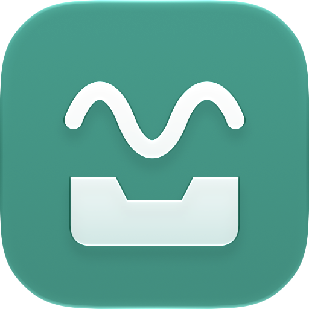
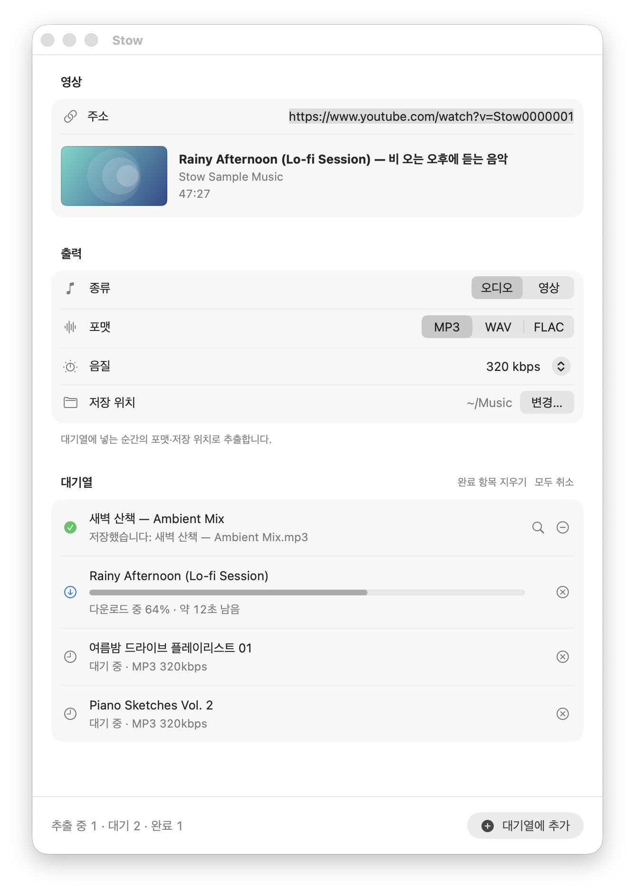
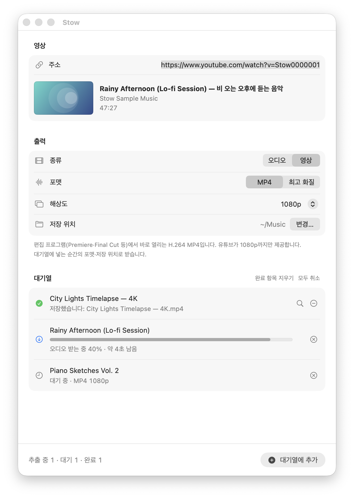
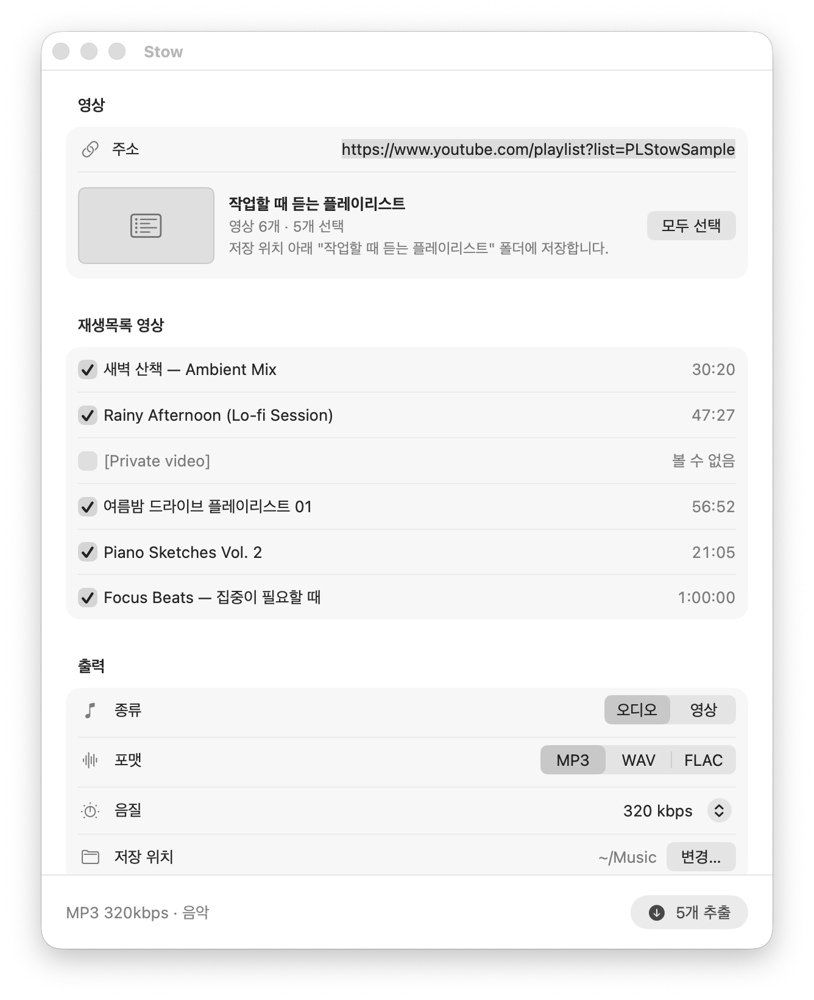
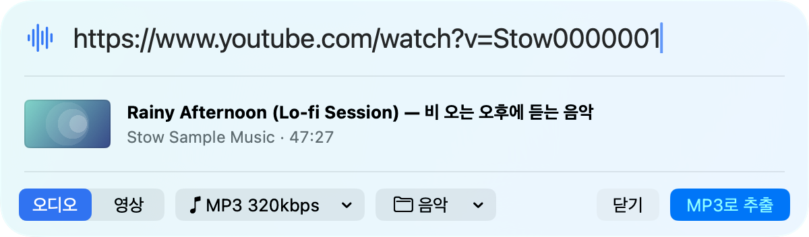

<div align="center">



# Stow

**유튜브 링크를 붙여 넣으면 오디오(MP3·WAV·FLAC)나 영상(MP4)으로 저장하는 macOS 앱**

광고도, 회원가입도, 수시로 바뀌는 다운로드 사이트도 없이 내 Mac에서 바로 받습니다.

[](https://github.com/choitjddn0311/stow/releases/latest)
[](#필요-환경)
[](#필요-환경)
[](LICENSE)

[**다운로드**](https://github.com/choitjddn0311/stow/releases/latest) · [웹사이트](https://choitjddn0311.github.io/stow/) · [사용법](#사용법) · [자주 묻는 질문](#자주-묻는-질문) · [English](README.en.md)

<picture>
  <source media="(prefers-color-scheme: dark)" srcset="docs/images/main-dark.png">
  
</picture>

</div>

## 왜 Stow인가요?

유튜브 다운로드 사이트는 광고가 많고, 주소가 자주 바뀌어 꾸준히 쓰기 어렵습니다.
Stow는 웹사이트에 의존하지 않는 Mac 앱이라 링크만 붙여 넣으면 원하는 포맷과 위치로 바로 저장합니다.
영상 편집자와 크리에이터가 작업 중에 빠르게 쓸 수 있도록 만들었습니다.

## 주요 기능

- **붙여 넣기만 하면 끝** — 주소를 붙여 넣으면 제목·채널·길이·썸네일을 자동으로 불러옵니다
- **원하는 포맷과 음질** — MP3(128/192/320kbps), WAV, FLAC. 제목·아티스트 같은 메타데이터를 함께 넣습니다
- **영상도 그대로** — 편집 프로그램에서 바로 열리는 MP4(1080p까지)나 최고 화질(4K까지)로 받습니다. 다시 인코딩하지 않아 화질이 떨어지지 않습니다
- **대기열과 재생목록** — 여러 영상을 넣으면 차례로 추출하고, 재생목록은 원하는 영상만 골라 한 번에 담습니다
- **어디서든 빠른 추출** — 단축키 ⌥⌘Y로 어느 앱에서든 작은 패널을 열고, 클립보드의 주소를 바로 불러옵니다
- **알아서 최신 상태 유지** — 앱 새 버전을 알려 주고, 추출 엔진(yt-dlp)은 유튜브가 바뀌어도 자동으로 업데이트합니다
- **안전한 저장** — 같은 이름의 파일이 있으면 덮어쓰지 않고 번호를 붙입니다. 저장 위치와 포맷을 기억합니다
- **macOS다운 화면** — 시스템 설정과 같은 모양, 라이트·다크 모드, 키보드만으로 조작, VoiceOver 지원

## 다운로드와 설치

### 필요 환경

- macOS 14 Sonoma 이상
- Apple Silicon(M1 이후) Mac — Intel Mac은 지원하지 않습니다

### 설치

1. [Releases](https://github.com/choitjddn0311/stow/releases/latest)에서 `Stow-<버전>.dmg`를 받습니다.
2. DMG를 열고 Stow를 "Applications"(응용 프로그램) 폴더로 끌어다 놓습니다.
3. Stow는 아직 Apple 개발자 서명·공증을 받지 않아서, **처음 열 때 한 번만** 허용해야 합니다.
   - **macOS 15 Sequoia 이후**: Stow를 열면 "악성 코드가 없음을 확인할 수 없습니다" 경고가 나옵니다. "완료"를 누른 뒤
     **시스템 설정 → 개인정보 보호 및 보안**의 "보안" 항목에서 "그래도 열기"를 누르고 암호나 Touch ID로 확인합니다.
     다시 Stow를 열고 "열기"를 누릅니다.
   - **macOS 14 Sonoma**: Finder의 응용 프로그램 폴더에서 Stow를 Control-클릭(또는 우클릭) → "열기" → 경고창에서 "열기"를 누릅니다.

한 번 열고 나면 이후에는 경고 없이 열리고, 새 버전은 앱 안에서 바로 설치할 수 있습니다.

<details>
<summary>터미널로 열기, 받은 파일 확인하기</summary>

- 버전과 관계없이 `xattr -dr com.apple.quarantine /Applications/Stow.app`로도 열 수 있습니다.
- 받은 파일이 맞는지는 릴리스에 함께 올린 `.sha256`과 `shasum -a 256 Stow-<버전>.dmg` 결과를 비교해 확인할 수 있습니다.

</details>

## 사용법

### 영상 하나 추출하기

1. 유튜브 영상 주소를 복사해 Stow의 주소란에 붙여 넣습니다. 영상 정보가 자동으로 나타납니다.
2. 포맷(MP3·WAV·FLAC)과 음질, 저장 위치를 고릅니다. 다음에 열 때도 그대로 기억합니다.
3. **Return**(또는 "MP3로 추출" 버튼)을 누르면 추출이 시작되고, 끝나면 알림이 옵니다.

추출 중에도 다른 영상을 계속 넣을 수 있습니다. 대기열에 차례로 쌓이고 하나씩 처리됩니다.
대기열 항목을 오른쪽 클릭하면 다시 시도·Finder에서 보기·제목이나 주소 복사를 할 수 있습니다.

### 영상 받기

"출력"의 **종류**를 **영상**으로 바꾸면 영상 파일로 받습니다. 오디오와 영상 설정은 따로 기억합니다.

- **MP4**: Premiere·Final Cut 같은 편집 프로그램과 QuickTime에서 바로 열리는 H.264 영상입니다. 유튜브가 H.264를 1080p까지만 제공해 해상도는 1080p·720p·480p 중에서 고릅니다.
- **최고 화질**: 4K 이상까지 가장 높은 화질로 받습니다. 대부분 AV1 코덱의 MP4이며, QuickTime에서는 M3 이후 Mac에서 열립니다. 일부 영상은 WebM·MKV로 받으며 IINA·VLC 같은 플레이어가 필요할 수 있습니다.

고른 해상도가 없는 영상은 그보다 낮은 것 중 가장 높은 해상도로 받습니다. 영상과 오디오를 따로 받은 뒤 다시 인코딩하지 않고 한 파일로 합칩니다.

<picture>
  <source media="(prefers-color-scheme: dark)" srcset="docs/images/video-dark.png">
  
</picture>

### 재생목록에서 골라 받기

재생목록 주소를 붙여 넣으면 영상 목록이 나옵니다. 받을 영상만 체크하고 추출하면
저장 위치 아래 재생목록 이름의 폴더에 저장됩니다. 비공개·삭제된 영상은 자동으로 빠집니다.

<p align="center">
  
</p>

### 어느 앱에서든 빠른 추출

어느 앱에서든 **⌥⌘Y**(설정에서 변경)를 누르면 작은 패널이 뜹니다.
클립보드에 유튜브 주소가 있으면 자동으로 채워 불러오고, **Return**을 누르면 지금 설정으로 대기열에 넣고 패널이 닫힙니다.

<picture>
  <source media="(prefers-color-scheme: dark)" srcset="docs/images/panel-dark.png">
  
</picture>

패널 아래 줄 맨 왼쪽에서 오디오·영상을 바꾸고, 그 옆 칩으로 포맷과 저장 위치(최근 폴더 최대 5개)를 바로 바꿀 수 있습니다.

창을 닫아도 Stow는 메뉴 막대에 남아 단축키가 동작합니다. 완전히 끝내려면 ⌘Q나 메뉴 막대 메뉴의 "Stow 종료"를 쓰세요.

## 자주 묻는 질문

<details>
<summary><b>"유튜브가 요청을 막았습니다"라고 나와요</b></summary>

짧은 시간에 요청이 많으면 유튜브가 잠시 막을 수 있습니다. 대기열이 자동으로 멈추니, 잠시 뒤 "다시 시도"를 눌러 주세요.
계속 실패하면 메뉴 **Stow → 엔진 업데이트 확인…**으로 추출 엔진을 최신으로 바꿔 보세요.

</details>

<details>
<summary><b>어제까지 되던 영상이 갑자기 안 받아져요</b></summary>

유튜브가 바뀌면 추출 엔진(yt-dlp)도 고쳐져야 합니다. Stow는 하루에 한 번 엔진 새 버전을 자동으로 받습니다.
바로 받으려면 메뉴 **Stow → 엔진 업데이트 확인…**을 누르세요. 새 엔진에 문제가 있으면 "앱에 들어 있는 엔진으로 되돌리기"로 돌아갈 수 있습니다.

</details>

<details>
<summary><b>유튜브 말고 다른 사이트도 되나요?</b></summary>

지금은 유튜브 영상과 재생목록만 지원합니다. 채널 페이지 주소는 받지 않습니다. 라이브 방송은 끝난 뒤에 받을 수 있습니다.

</details>

<details>
<summary><b>Intel Mac에서도 쓸 수 있나요?</b></summary>

아직은 Apple Silicon(M1 이후) Mac만 지원합니다.

</details>

<details>
<summary><b>WAV·FLAC은 음질이 어떻게 되나요?</b></summary>

유튜브 원본 오디오를 그대로 무손실 포맷에 담습니다(샘플레이트 유지). 원본보다 음질이 좋아지지는 않지만, 다시 압축하지 않아 편집용으로 좋습니다.

</details>

## 개인정보와 네트워크

Stow는 계정·로그인·분석 도구가 없고, 모든 처리는 내 Mac에서 합니다.
영상 정보 조회·다운로드 외에는 새 버전 확인을 위해서만 GitHub(`api.github.com`, `github.com`, `*.githubusercontent.com`)에 접속합니다.

- **앱 새 버전**: 앱을 시작할 때와 켜져 있는 동안 1시간마다 작은 업데이트 목록 파일을 확인하고, 설치 전에 묻습니다.
  "나중에"로 미룬 업데이트는 하루에 한 번만 다시 묻고, 그사이에는 메뉴 막대 메뉴의 "새 버전 설치…"로 설치할 수 있습니다.
- **추출 엔진(yt-dlp)**: 하루에 한 번 확인해 자동으로 받습니다. 공식 체크섬과 실행 검사를 통과한 파일만 씁니다.
- **클립보드**: 빠른 추출 패널을 열 때 주소처럼 보일 때만 읽고, 유튜브 주소가 아니면 쓰지 않습니다(macOS 15.4 이상에서는 처음 읽을 때 확인창이 뜹니다).

이름이나 파일 같은 개인 정보는 보내지 않지만, IP 주소와 접속 시각은 GitHub에 남습니다.

## 이용 안내

Stow는 본인이 저작권을 가지고 있거나 사용 허락을 받은 영상과 그 오디오를 내려받는 도구입니다.
다른 사람의 저작물을 허락 없이 내려받거나 배포하면 저작권법이나 YouTube 이용약관을 위반할 수 있으며,
그에 따른 책임은 사용자에게 있습니다.
Stow 개발자는 사용자가 Stow로 내려받은 콘텐츠와 그 사용에 대해 어떠한 법적 책임도 지지 않습니다.

## 오픈소스 구성 요소

Stow는 아래 오픈소스 프로그램을 앱 안에 함께 넣어 실행합니다. 구성 요소와 라이선스 원문은 앱 메뉴 **Stow → 오픈소스 라이선스…**에서 볼 수 있습니다.

| 구성 요소 | 용도 | 라이선스 |
|---|---|---|
| [yt-dlp](https://github.com/yt-dlp/yt-dlp) (zipimport 버전) | 영상 정보 조회, 다운로드 | Unlicense (MIT·ISC 포함 코드 일부) |
| [Python](https://www.python.org) ([python-build-standalone](https://github.com/astral-sh/python-build-standalone)) | yt-dlp 실행 | PSF 라이선스 등 |
| [deno](https://deno.com) | 유튜브 JavaScript 처리 | MIT |
| [FFmpeg](https://ffmpeg.org) | 오디오 변환, 영상·오디오 합치기 | LGPL 2.1 이상 |
| [LAME](https://lame.sourceforge.io) | MP3 인코딩 | LGPL |
| [Sparkle](https://sparkle-project.org) | 앱 자동 업데이트 | MIT (포함된 bsdiff·ed25519 등은 BSD·zlib 계열) |
| [KeyboardShortcuts](https://github.com/sindresorhus/KeyboardShortcuts) | 빠른 추출 전역 단축키 | MIT |

GPL 구성 요소는 넣지 않습니다. FFmpeg와 LAME은 GPL 구성 없이 LGPL로 직접 빌드했고,
앱에 들어 있는 버전의 원본 소스(`ffmpeg-<버전>.tar.xz`, `lame-<버전>.tar.gz`)는 각 버전의
[릴리스](https://github.com/choitjddn0311/stow/releases) Assets에 DMG와 함께 올려 두었습니다.
빌드 방법은 같은 버전 소스 코드의 [`scripts/build-ffmpeg.sh`](scripts/build-ffmpeg.sh)에 있습니다.

## 직접 빌드하기

Xcode 26 이상과 Apple Silicon Mac이 필요합니다.

```bash
git clone https://github.com/choitjddn0311/stow.git
cd stow
scripts/fetch-binaries.sh   # yt-dlp, Python, deno 받기(버전·체크섬 고정)
scripts/build-ffmpeg.sh     # FFmpeg + LAME(LGPL) 빌드
xcodebuild -project Stow.xcodeproj -scheme Stow -destination 'platform=macOS,arch=arm64' test
scripts/release.sh          # 배포용 DMG(build/release/)
```

<details>
<summary>프로젝트 구조</summary>

| 경로 | 내용 |
|---|---|
| `Stow/App/` | 앱 시작, 창·메뉴 막대·업데이트 연결 |
| `Stow/Features/` | 화면별 기능: 추출(`Extract`), 대기열(`Queue`), 빠른 추출 패널(`QuickPanel`), 라이선스, 설정, 공용 컴포넌트(`Shared`) |
| `Stow/Core/` | 엔진 실행(`Engine`: yt-dlp 호출·진행률·오류), 모델, 설정 |
| `StowTests/` | Swift Testing 단위·화면 테스트 |
| `scripts/` | 엔진 준비, FFmpeg 빌드, 배포 스크립트 |
| `Stow/AppIcon.icon` | 앱 아이콘(Icon Composer 문서, 라이트·다크·색조·투명) |

SwiftUI(필요한 곳만 AppKit)와 Swift 6 엄격한 동시성으로 작성했습니다. 추출 엔진은 앱 안에 넣은 yt-dlp를 별도 프로세스로 실행하고,
작업마다 임시 폴더에서 추출한 뒤 결과만 저장 위치로 옮깁니다.

</details>

## 기여하기

버그 제보와 기능 제안은 [Issues](https://github.com/choitjddn0311/stow/issues)에 남겨 주세요.
코드 기여는 Pull Request로 받습니다. 보내기 전에 위의 `xcodebuild … test`가 통과하는지 확인해 주세요.
앱 화면 문구는 한국어로 씁니다.

## 라이선스

Stow의 소스 코드는 [MIT 라이선스](LICENSE)를 따릅니다. 앱에 함께 들어 있는 구성 요소는 각자의 라이선스를 따릅니다([오픈소스 구성 요소](#오픈소스-구성-요소)).
